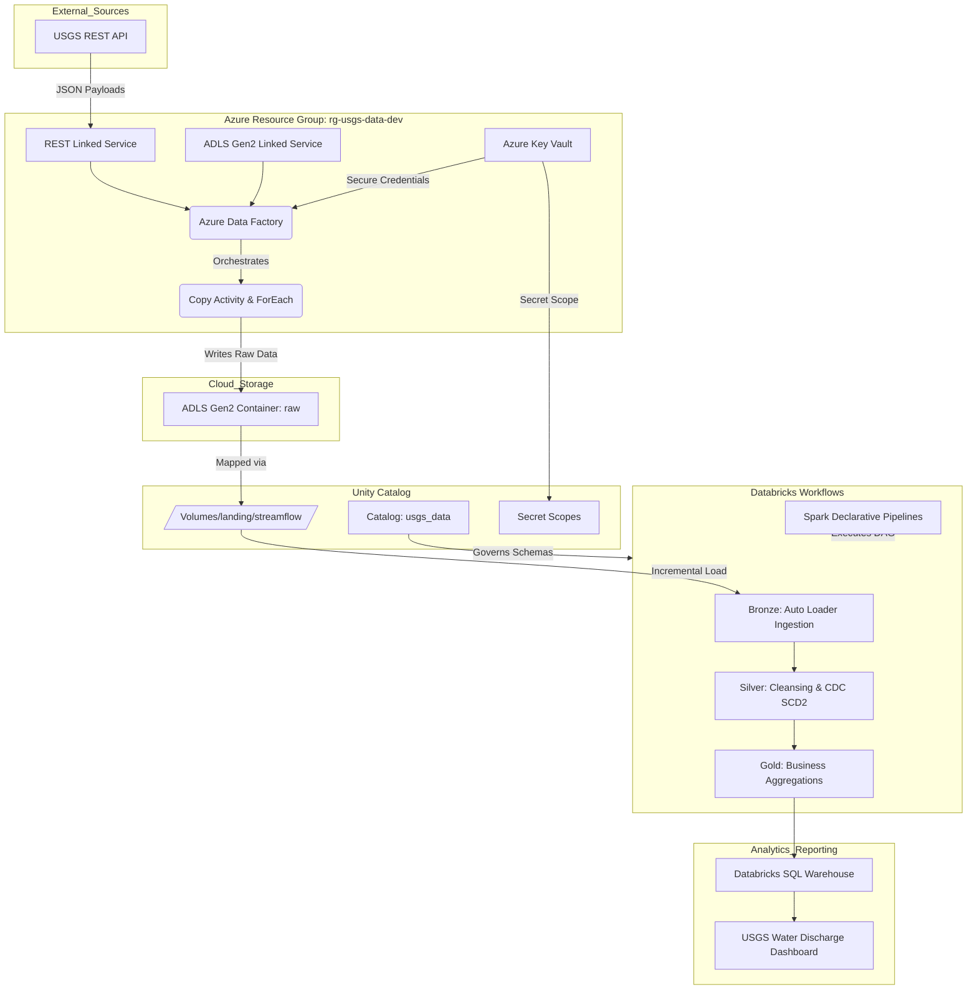

# 🌊 Cloud Lakehouse & Automated ETL Pipeline

     

An enterprise-grade, end-to-end **Data Engineering and Lakehouse Solution** deployed on **Microsoft Azure** and **Databricks**. This project processes hydrologic and streamflow data from the **United States Geological Survey (USGS)** REST API.

The architecture bridges cloud orchestration, secure credential storage, fine-grained data governance, and declarative data engineering. It implements a complete data processing lifecycle: from automated API ingestion via Azure Data Factory, through a PySpark-driven Medallion Architecture (Bronze, Silver, Gold), culminating in automated Databricks SQL dashboards.

---

## 🚀 Business Value & Key Features

*   **Automated Data Ingestion:** Zero-touch daily extraction of API data utilizing ADF dynamic parameterization.
*   **Data Quality Assurance:** Declarative data quality checks with quarantine mechanisms for bad records.
*   **Historical Tracking:** Implements Slowly Changing Dimensions (SCD Type 2) to maintain a historical audit trail of monitoring station metadata.
*   **Cost-Optimized Compute:** Leverages Databricks Job clusters, Auto Loader incremental processing, and Delta Lake Liquid Clustering for maximum query performance at minimum infrastructure cost.

---

## 📐 Architecture & Data Flow



---

## ⚙️ Core System Components

### 1. Cloud Infrastructure (`rg-usgs-data-dev`)
The entire solution is securely isolated within a dedicated Azure Resource Group containing all necessary cloud-native services:
*   **Azure Data Factory (ADF):** The orchestration backbone (`adf-usgs-data-dev`).
*   **Azure Databricks:** Unified analytics platform (`dbw-usgs-data-dev`).
*   **Azure Key Vault:** Centralized vault (`kv-usgs-data-dev`) securing API keys and storage credentials.
*   **ADLS Gen2:** Hierarchical storage account (`stusgsdatadev`) serving as the underlying data lake.

### 2. Automated Ingestion (Azure Data Factory)
ADF orchestrates the daily polling of the USGS API using secure linked services.
*   **Dynamic Orchestration:** Pipelines utilize `ForEach` loop iterations and `Copy data` activities to iterate over multiple monitoring stations dynamically.
*   **Managed Identities:** Authentication to ADLS Gen2 is handled via Azure Managed Identities, enforcing strict cloud-native security.

### 3. Data Governance (Databricks Unity Catalog)
Data assets are strictly governed using Unity Catalog to separate environments and enforce access control:
*   **Medallion Schemas:** Separated explicitly into `bronze`, `silver`, and `gold` schemas.
*   **External Volumes:** ADLS Gen2 paths are mapped as external volumes (`/Volumes/usgs_data/...`) to grant PySpark processes secure, POSIX-compliant file access.

---

## 🛡️ Data Quality & Testing

Robust data quality measures are natively integrated into the transformation layer:
*   **Expectations:** Data quality rules are defined using declarative expectations (`@dlt.expect_or_drop`, `@dlt.expect_or_fail`).
*   **Quarantine / Rescue:** Invalid JSON payloads or unexpected schema evolutions are captured safely in the Bronze layer via Auto Loader's `_rescue_data` column, ensuring pipeline continuity without data loss.

---

## 🏅 Data Transformation & Medallion Architecture

Data engineering pipelines execute a strict DAG structure: `Bronze -> Silver -> Gold -> Dashboard`.

### 🥉 Bronze Layer (Raw Ingestion)
*   **Logic:** Utilizes **Auto Loader (`cloudFiles`)** to incrementally and efficiently ingest raw JSON payloads. Enforces schema rules and captures metadata (`_metadata.file_path`).

### 🥈 Silver Layer (Cleansing & SCD Type 2)
*   **Logic:** Flattens complex, nested JSON arrays into tabular formats.
*   **Change Data Capture (CDC):** Uses `dp.apply_changes` to maintain full historical tracking of station state changes via **Slowly Changing Dimensions (SCD) Type 2**.

### 🥇 Gold Layer (Aggregations & Analytics)
*   **Logic:** Aggregates cleansed streamflow records into highly optimized fact and dimension tables. Utilizes Delta Lake Liquid Clustering on frequent filter keys (`date_key`, `station_id`) to maximize downstream query performance.

---

## 🔄 CI/CD & DevOps Integration

*   **Git Integration:** Source code is version-controlled via GitHub and synced directly to Databricks Repos.
*   **Infrastructure as Code (IaC):** Core Azure resources (ADF, Key Vault, ADLS) can be automated using ARM templates or Terraform (configurations stored in the `infrastructure/` directory).

---

## 📊 Analytics & Dashboards

The final step in the ETL job triggers an automated refresh of the Databricks SQL Dashboard.

The **USGS Water Discharge Analysis** dashboard visualizes:
*   **KPI Widgets:** Real-time tracking of Average Daily Discharge, Max Discharge, and Min Discharge (ft³/s).
*   **Geospatial Mapping:** Interactive map visualizing the exact coordinates of the monitoring stations.
*   **Time-Series Trends:** Line charts plotting the average daily discharge trends over the observation window.

---

## 📋 Prerequisites

To deploy and test this project locally or in your own Azure tenant, you will need:
1.  **Azure Subscription** with Contributor access to provision Resource Groups, ADF, Key Vault, and Databricks.
2.  **Databricks CLI** configured with a Personal Access Token (PAT).
3.  **Python 3.9+** for local PySpark development.
4.  *(Optional)* **Azure CLI** or **Terraform** for Infrastructure as Code deployment.

---

## 📂 Repository Structure

```text
.
├── adf/                             # ARM templates & JSON pipeline definitions for ADF
├── infrastructure/                  # IaC templates (Bicep/Terraform) for Azure setup
├── assets/                          # Architecture diagrams, ERDs, and visual previews
│   ├── architecture_diagram.drawio
│   └── powerbi_preview.png
├── databricks/                      # Core Databricks Workspace Files
│   ├── PL_USGS_Bronze_DEV/          # Auto Loader ingestion logic
│   ├── PL_USGS_Silver_DEV/          # Cleansing & CDC SCD Type 2 logic
│   └── PL_USGS_Gold_DEV/            # Business aggregations & KPIs
├── .gitignore                       # Exclusion rules for temporary files, tokens, and configs
└── README.md                        # Comprehensive project documentation
```

---

## 🛠️ End-to-End Deployment Guide

1. **Infrastructure Setup:** Deploy `rg-usgs-data-dev`, ADLS Gen2 (`stusgsdatadev`), Azure Data Factory, Key Vault, and Databricks workspace.
2. **Secrets Configuration:** Store storage access keys and API credentials in Azure Key Vault. Bind the Key Vault to Databricks using a Secret Scope.
3. **ADF Orchestration:** Import the ADF templates, configure Linked Services (`ls_rest_api`, `ls_adls_gen2`), and test the initial API extraction.
4. **Lakehouse Execution:** Sync this repository into Databricks Repos, create a unified Databricks Job chaining the Bronze, Silver, and Gold notebooks, and run the pipeline.

---

## 🔮 Future Enhancements

*   **Streaming Analytics:** Transition from batch ADF triggers to Databricks Structured Streaming utilizing Azure EventHubs for near real-time ingestion.
*   **Machine Learning Integration:** Implement Databricks AutoML to forecast future water discharge rates based on historical trends and external weather datasets.
